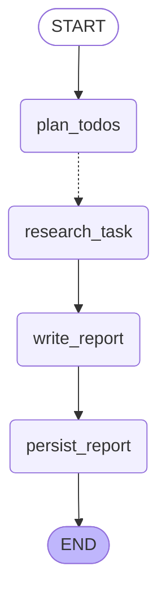

# Deep Research Agent · LangGraph

> 输入一个研究主题，Agent 自动拆解成 3~5 个子任务 → **并行**联网检索 → 逐任务结构化总结 →
> 汇总成一份带来源的 Markdown 研究报告。全过程通过 SSE 实时推送，产物自动归档成一组带索引的笔记。

**技术栈**：Python 3.10+ · LangGraph 1.x · LangChain 1.x · FastAPI · Vue 3

**定位**：`code/chapter14/helloagents-deepresearch/backend/`（书籍配套框架 HelloAgents 版）的
**LangGraph 重写版**——同样的工作流、同样的 HTTP/SSE 契约，前端零改动即可切换。
为什么要重写、与上游差在哪，见 [docs/ENGINEERING_NOTES.md](docs/ENGINEERING_NOTES.md)。

---

## 它能做什么

一次研究分四个阶段，每个阶段都有可验收的产物：

| 阶段 | 做什么 | 产物 |
| --- | --- | --- |
| ① 规划 | 用结构化输出把主题拆成 3~5 个互补子任务（含检索关键词） | `todo_list` 事件 + 任务卡片 |
| ② 并行检索 | N 个子任务在**同一个 superstep 并发执行**：确定性保底检索 + ReAct 工具循环补充验证 | `sources` 事件（真实 URL）+ `tool_call` 事件 |
| ③ 逐任务总结 | 每个任务产出结构化总结：`summary_markdown` / `key_findings` / **`not_verified`** / `confidence` | `task_summary_chunk` + 任务笔记 |
| ④ 汇总成稿 | 把结构化结果拼成材料，流式产出研究报告，落盘为 `conclusion` 笔记 | `final_report` + 报告笔记 + 目录索引 |



`plan_todos -.-▶ research_task` 是**动态扇出**：条件边返回 N 个 `Send`，N 个子任务并发执行，
完成后再 fan-in 到 `write_report`。图结构由 `python scripts/export_graph.py` 从代码导出，
文档不会和实现漂移。

---

## 效果示例

界面（截图来自真实运行，主题：*Mamba 与线性注意力的长上下文能力对比*）：

| 研究完成：5 个子任务全部完成 | 最终报告：带来源的结构化 Markdown |
| --- | --- |
| [](docs/ui-completed.png) | [](docs/ui-report.png) |

> 左侧是任务清单与完成进度，中间是实时阶段记录（示例中 76 条）与工具调用，
> 右侧是任务总结与来源列表（真实 URL）。所有内容都通过 SSE 在运行过程中实时推送。

### 产出的笔记目录

每次研究都会把产物归档成一组带索引的笔记（下面是一次真实运行的目录）：

```
notes/
└── transformer机制-20261013-161650/
    ├── 00-研究概要.md              目录索引
    ├── 01-核心原理与数学.md
    ├── 02-高效架构变体.md
    ├── 03-长上下文技术.md
    ├── 04-工程训练部署.md
    ├── 05-局限与路线之争.md
    └── 研究报告.md
```

`00-研究概要.md` 是自动生成的索引 —— 任务状态、可信度自评、来源条数一目了然：

| # | 任务 | 状态 | 可信度 | 来源 | 笔记 |
| --- | --- | --- | --- | --- | --- |
| 1 | 核心原理与数学 | completed | high | 25 | [01-核心原理与数学.md](<01-核心原理与数学.md>) |
| 2 | 高效架构变体 | completed | high | 53 | [02-高效架构变体.md](<02-高效架构变体.md>) |
| 3 | 长上下文技术 | completed | medium | 63 | [03-长上下文技术.md](<03-长上下文技术.md>) |
| 4 | 工程训练部署 | completed | medium | 35 | [04-工程训练部署.md](<04-工程训练部署.md>) |
| 5 | 局限与路线之争 | completed | medium | 39 | [05-局限与路线之争.md](<05-局限与路线之争.md>) |

最终报告带来源标注（原文摘录）：

> ## 1. 背景概览
>
> Transformer 出自 Vaswani 等 2017 年论文《Attention Is All You Need》（Google），是纯 Attention 的
> Encoder-Decoder 结构，不使用 RNN/CNN（任务 1）。base 配置为 N=6 层、d_model=512、h=8 头、
> d_k=d_v=64、d_ff=2048、dropout=0.1，训练 100K 步（任务 1）。
>
> 从 2017 年到本报告日期（2026-10-13），该机制已沿四条主线演化…

每次运行结束还会通过 SSE 返回用量（LLM 调用次数、token、按模型估的成本）：

```json
{"type": "usage", "llm_calls": 16, "input_tokens": 159652, "output_tokens": 16744,
 "total_tokens": 176396, "estimated_cost_usd": null, "pricing_known": false,
 "models": [{"model": "deepseek-flash", "calls": 16, "total_tokens": 176396}]}
```

> 价目表里没有的模型会如实标 `pricing_known: false` —— 宁可不知道，也不编一个价格。
>
> `notes/` 目录不入库，本节所有示例（截图、目录、报告摘录、用量）均取自笔者的真实运行记录。

---

## 核心特性

| 能力 | 实现 | 说明 |
| --- | --- | --- |
| **动态并行** | `Send` 扇出 + `operator.add` reducer | N 个子任务同一 superstep 并发，**没有一行线程/锁代码** |
| **结构化输出** | `with_structured_output` + 4 级降级 | 任务清单与总结都是 Pydantic 对象，不是正则抠出来的 JSON |
| **真工具调用** | `@tool` + `bind_tools` | `web_search` / `note_read` / `note_update`，参数与结果都来自消息历史 |
| **可插拔搜索** | httpx 直连 REST | Tavily / Perplexity / SearXNG / DuckDuckGo，无需额外 SDK |
| **实时进度** | SSE 10 类事件 | 状态、任务清单、来源、工具调用、总结、报告、用量… |
| **成本与追踪** | `UsageTracker` + LangSmith | token/耗时/按模型估成本；LangSmith 一个开关全链路 trace |
| **诚实降级** | 4 级降级 + `errors` 通道 | 任何一环失败都有可交付产物，并如实声明哪些内容未经核实 |
| **笔记归档** | `NoteStore` | 一次研究一个目录，带索引、序号化文件名、合法 YAML 头 |
| **离线可测** | 假模型 + 假搜索 | **没有 API Key 也能跑完整流水线**，可直接当 CI 回归 |

---

## 快速开始

### 1. 环境要求

- Python **3.10+**（实测 3.14.7 与 3.12 均可；3.14 会打印一句 langchain-core 的 pydantic v1 兼容告警，仅是提示）
- 一个 OpenAI 兼容的模型端点（DeepSeek / OpenAI / 通义 / Ollama / vLLM 均可）

### 2. 安装

```bash
cd backend-langgraph

python -m venv .venv
.venv/Scripts/activate            # Windows；Linux/macOS: source .venv/bin/activate

pip install -e .                  # 核心依赖
pip install -e ".[duckduckgo]"    # 可选：用 DuckDuckGo 免 key 搜索
pip install -e ".[observability]" # 可选：LangSmith 追踪
pip install -e ".[agents]"        # 可选：切到官方新的 create_agent API
```

### 3. 配置

```bash
cp .env.example .env
```

最少三行就能跑（以 DeepSeek 为例）：

```env
LLM_MODEL_ID=deepseek-chat
LLM_API_KEY=sk-xxxx
LLM_BASE_URL=https://api.deepseek.com
```

搜索后端按你的网络条件选一个：

| `SEARCH_API` | 需要 | 说明 |
| --- | --- | --- |
| `tavily` | `TAVILY_API_KEY` | **推荐**：走 REST，有免费额度，中国大陆网络实测可达 |
| `searxng` | 自建实例 `SEARXNG_URL` | 完全自控，但需自行部署并配置可达的上游引擎 |
| `duckduckgo` | `pip install ddgs` | 免 key；但中国大陆网络下其上游引擎（google/bing/yahoo/brave…）实测全部不可达 |
| `perplexity` | `PERPLEXITY_API_KEY` | 提供「AI 直答 + 引用」，需确认网络可达 |
| `advanced` | — | 别名：有 Tavily key 就用 Tavily，否则退回 DuckDuckGo |

> 想省成本可以调 `MAX_TASKS`（子任务数，默认 5）与 `FETCH_FULL_PAGE`（是否抓整页正文，默认 True）。
> 用 thinking 类模型（`deepseek-reasoner` / `deepseek-flash` 等）建议设 `LLM_MAX_TOKENS=8192`。

### 4. 启动服务

```bash
python src/main.py
# 或
uvicorn main:app --app-dir src --port 8000
```

后端是**纯 API，没有首页**：用 `http://127.0.0.1:8000/docs`（Swagger UI）手测接口。
配套前端在本仓库的 `frontend/`：

```bash
cd ../frontend
npm install
npm run dev            # 默认 http://localhost:5174
```

### 5. 自检脚本（成本从 0 到几厘钱）

```bash
python scripts/doctor.py                 # 配置体检：模型 / 工具调用 / 结构化输出 / 搜索后端逐项真打
python scripts/dry_run.py                # 纯离线端到端：假模型 + 假来源，零成本，可当 CI 回归
python scripts/api_smoke.py              # HTTP/SSE 层：路由 + CORS + 事件契约 + 参数校验
python scripts/dry_run.py --live-llm     # 真模型 + 固定假来源（隔离变量，几厘钱）
python scripts/live_run.py --topic "…"   # 对运行中的服务发真实请求，实时看事件流与成本
```

**联调出问题先跑 `doctor.py`**：它把「模型端点不给力」和「搜索不通」拆开逐项真打，
并打印**异常原文**，能直接定位该改 `.env` 还是该换搜索后端。

---

## API 一览

| 方法 | 路径 | 说明 |
| --- | --- | --- |
| GET | `/healthz` | 健康检查 |
| GET | `/config` | 当前**生效**配置（密钥已遮盖）——改完 `.env` 忘了重启时用它确认 |
| POST | `/research` | 同步研究，返回 `{report_markdown, todo_items, usage, …}` |
| POST | `/research/stream` | SSE 事件流（前端使用这条） |
| GET | `/research/graph` | 导出 Mermaid 图结构 |

`POST /research/stream` 的事件类型：

| 事件 | 关键字段 | 用途 |
| --- | --- | --- |
| `status` | `message`, `task_id?`, `step?` | 进度日志 |
| `todo_list` | `tasks[]`（含 `note_id` / `note_path`） | 渲染任务卡片 |
| `task_status` | `task_id`, `status`, `summary?`, `sources_summary?` | 任务状态与结果 |
| `sources` | `task_id`, `latest_sources`, `raw_context`, `backend` | 来源面板 |
| `task_summary_chunk` | `task_id`, `content` | 总结渲染 |
| `tool_call` | `event_id`, `agent`, `tool`, `parameters`, `result`, `task_id`, `note_id` | 工具调用面板 |
| `report_note` | `note_id`, `title`, `content` | 结论笔记 |
| `final_report` | `report`, `note_id`, `note_path` | 报告正文 |
| `usage` | `llm_calls`, `total_tokens`, `estimated_cost_usd`, `models[]` | 用量与成本 |
| `error` / `done` | `detail` / — | 错误与结束 |

---

## 架构

### 节点职责

| 节点 | 职责 | 关键实现 |
| --- | --- | --- |
| `plan_todos` | 主题 → 3~5 个子任务 | `with_structured_output(TodoList)` |
| `research_task` | 单个子任务：保底检索 → ReAct 工具循环 → 结构化总结 | `Send` 载荷 + `create_react_agent` + `TaskSummary` |
| `write_report` | 汇总全部结构化结果，流式产出报告 | `llm.astream` + 确定性兜底拼装 |
| `persist_report` | 报告落盘 + 写目录索引 | `NoteStore`（幂等） |

### 状态与归并

`graph/state.py` 用 `TypedDict` 声明状态，**归并语义写在字段上**：

```python
task_results:     Annotated[list[TaskResult], operator.add]   # N 个分支并发 append
sources_gathered: Annotated[list[str], operator.add]
model_calls:      Annotated[int, operator.add]                # 计数也不用手写锁
todos:            list[TodoItem]                              # 单值字段，last-write-wins
```

### 目录结构

```
backend-langgraph/
├── pyproject.toml            依赖清单（langgraph / langchain-openai / fastapi / httpx）
├── .env.example              环境变量样例
├── README.md                 本文档
├── docs/
│   ├── ENGINEERING_NOTES.md  设计决策与踩坑复盘（写给读代码的人）
│   └── graph.mmd             从代码导出的图结构
├── scripts/                  doctor / dry_run / api_smoke / live_run / fake_llm /
│                             migrate_notes / export_graph
└── src/
    ├── config.py             pydantic-settings 集中配置
    ├── prompts.py            各节点提示词
    ├── utils.py              纯文本工具函数
    ├── observability.py      LangSmith 开关 + token/成本统计
    ├── graph/
    │   ├── state.py          TypedDict 状态 + reducer
    │   ├── schemas.py        结构化输出模型（TodoList / TaskSummary）
    │   ├── llm.py            ChatModel 工厂 + 结构化输出降级
    │   ├── agents.py         ReAct 子图工厂（兼容新旧 Agent API）
    │   ├── tools.py          web_search / note_* 工具
    │   ├── events.py         SSE 事件构造（前端契约的唯一出口）
    │   ├── nodes.py          节点实现
    │   ├── builder.py        StateGraph 组装
    │   └── runner.py         面向 FastAPI 的调用封装
    ├── services/             搜索 dispatch / 笔记存储 / 文本清洗
    └── main.py               FastAPI 入口
```

---

## 常见问题

| 症状 | 处理 |
| --- | --- |
| 报告里写「无来源可核实」 | 搜索后端在当前网络不可达 → `python scripts/doctor.py --skip-search`，换 Tavily 或自建 SearXNG |
| 改了 `.env` 但行为没变 | `get_settings()` 是进程级缓存 → 重启后端；用 `GET /config` 确认生效配置 |
| 前端连不上，后端日志却没有任何请求 | CORS：浏览器把 `localhost` 与 `127.0.0.1` 当不同 Origin，需把实际访问地址写进 `CORS_ORIGINS`（默认已含 5173/5174/3000） |
| 结构化输出报 `Invalid json output:`（内容为空） | thinking 模型的推理 token 吃掉了输出预算 → 设 `LLM_MAX_TOKENS=8192` 或 `LLM_STRUCTURED_METHOD=prompted_json` |

完整的「症状 → 原因 → 处理」清单（含 8 条真机踩坑）见
[docs/ENGINEERING_NOTES.md](docs/ENGINEERING_NOTES.md) 的「排障手册」一节。

---

## 深入阅读

README 只讲**怎么用**；关于**为什么这么写**，见 [docs/ENGINEERING_NOTES.md](docs/ENGINEERING_NOTES.md)：

- **与上游 HelloAgents 版的逐项对照**：并发模型、工具调用方式、结构化输出、可观测性、依赖栈
- **9 个设计决策**，每个都写了取舍：动态扇出、结构化输出的四种实现与降级顺序、真工具调用、
  代码保底 + 模型增量、诚实降级、LangSmith 与成本统计、Agent API 换代兼容、笔记归档方案
- **排障手册**：8 条真机踩坑的「症状 → 原因 → 处理」，附具体报错原文
- **已知取舍与下一步**：为什么暂时不接 checkpointer、成本旋钮在哪、还能往哪走

---

## 来源与许可

- **上游项目**：[datawhalechina/hello-agents](https://github.com/datawhalechina/hello-agents)
  （Datawhale 开源教程项目），本项目是其中 `code/chapter14/helloagents-deepresearch` 的 LangGraph 重写版。
- **复用情况**：`utils.py` 的纯文本处理函数、提示词主体、HTTP/SSE 接口契约来自上游；
  图编排、状态归并、工具层、事件层、可观测性与全部测试脚本为本项目新增。
- **许可**：上游使用 **CC BY-NC-SA 4.0**（署名—非商业性使用—相同方式共享），
  本重写版作为衍生作品沿用同一许可：
  - ✅ 可以自由复制、修改、公开发布；
  - ⚠️ 必须保留对上游的署名；
  - ⚠️ **不得用于商业用途**（个人学习、作品集、面试演示没问题）；
  - ⚠️ 再分发时必须使用**同样的许可**。
